<div align="center">

# 해담시청 SOAR · 김명준 개인 포트폴리오

**공격에서 원복까지, PC 한 대에서 다시 재현한 보안 관제 자동화**

가상 해담시청 민원포털을 노리는 공격을 탐지하고, 티켓을 먼저 기록한 뒤 차단하고,<br>
차단 효과와 정상 사용자 유지, 승인 원복까지 **실제 요청으로** 확인한 교육용 랩입니다.


<br>


-212121?logo=pfsense&logoColor=white)

</div>

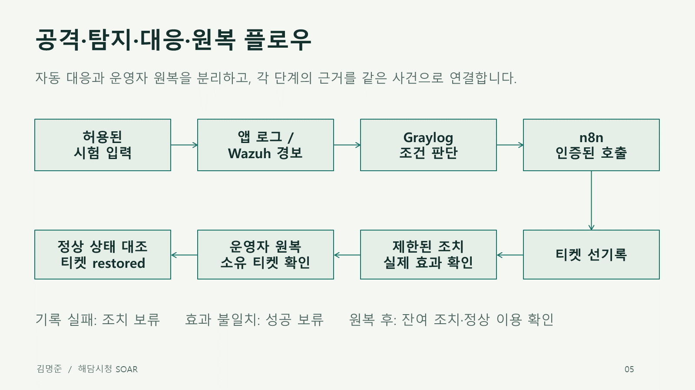

팀 캡스톤 [NoBugs-Aleph/aleph-soar-capstone](https://github.com/NoBugs-Aleph/aleph-soar-capstone)([공개 소개](https://github.com/NoBugs-Aleph/aleph-soar-public))은 학원 PC 두 대와 VMware 내부망에 나뉘어 있었습니다. 이 저장소는 그 구성을 **PC 한 대의 Docker 랩으로 처음부터 다시 설치**하고, 사례마다 새 볼륨에서 탐지·대응·원복을 실측한 개인 포트폴리오입니다. 팀원 코드는 출처를 밝혀 재사용했습니다([출처와 기여](docs/sources.md)).

## 목차

- [한눈에 보기](#한눈에-보기)
- [동작 흐름](#동작-흐름)
- [개인 랩 구성](#개인-랩-구성)
- [실제 화면](#실제-화면)
- [팀과 역할](#팀과-역할)
- [설치와 실행](#설치와-실행)
- [제출물과 문서](#제출물과-문서)
- [한계와 다음 단계](#한계와-다음-단계)
- [작업 방식](#작업-방식)

## 한눈에 보기

| 사례 | 실제 입력 | 탐지 | 대응과 확인한 효과 | 원복 |
| --- | --- | --- | --- | --- |
| **[S8](docs/s8-results.md)** 웹 탐색·로그인 반복 | 포털 404 + 로그인 실패 401 | 조건→판정 3.828초 | 차단 API까지 4.521초 · 공격 403, 정상 200 | 티켓 restored · 양쪽 200 |
| **[H1](docs/h1-results.md)** 민원 도배 *(개인 추가)* | 계정의 연속 민원 등록 | 조건→탐지 14.087초 | 제한 API까지 14.532초 · 작성만 429, 조회·다른 시민 유지 | 해제 후 작성 201 |
| **[S7](docs/panel-results-20261110.md)** 파일 무결성 *(제어판 버튼)* | 홈 변조 / 시험 파일 추가 | Wazuh FIM → Graylog | 복구 8.211초 · 격리 6.699초(효과 확인까지) | 티켓 restored · 홈 200 |
| **[P04](docs/s10-results-20261110.md)** pfSense 경계 차단 | 공격·정상 요청 | — | 공격만 연결 끊김, 정상 200 | 해제 후 양쪽 200 · 잔여 0 |
| **[S10](docs/s10-results-20261110.md)** 경계+포털 연쇄 | ICMP 차단 로그 + 404 + 401 | 입력→탐지 15.0초 | 포털·pfSense 두 차단까지 26.2초 | 원복 요청→restored 14.5초 |
| **[S1](docs/s1-results.md)** 로그인 반복 실패 | 같은 계정·IP 401 9회 | 조건→탐지 39.216초 | 차단 API까지 40.299초 · 공격 200→403→200, 정상 새 로그인 유지 | 티켓 restored · 활성 조치 0 |
| **[S4](docs/s4-results.md)** 실패+성공 결합 | 같은 계정·IP 401 5회 + 200 1회 | 조건→탐지 21.292초 | 잠금 API까지 22.734초 · 대상 200→401→200 · 옛 세션 무효 · 정상 유지 | 티켓 restored · 활성 조치 0 |
| **[S12](docs/s12-results.md)** 가용성 *(통제된 자원 경합)* | 실제 요청 증가 + 공유 슬롯 경합 | 요청 기준→탐지 17.966초 | 차단 API까지 24.704초 · 공격 403 · 정상 100/100 성공·지연 회복 | 양쪽 200 · 티켓 restored · 잔여 0 |

> 사례 이름을 누르면 결과 문서로 이동합니다. 시간은 모두 **개인 1회 관측값**이며 평균이나 보장값이 아닙니다. 성공은 API 200이 아니라 별도 클라이언트 요청으로 확인한 실제 효과(403·429·연결 끊김·해시 복구)와 원복 뒤 정상 응답으로 판정했습니다. 같은 이벤트 재전송은 추가 조치를 만들지 않았고, 오래된 티켓으로는 원복할 수 없었습니다. 실행 ID와 원천 증적은 각 결과 문서와 [`docs/evidence`](docs/evidence)에 있습니다.

## 동작 흐름

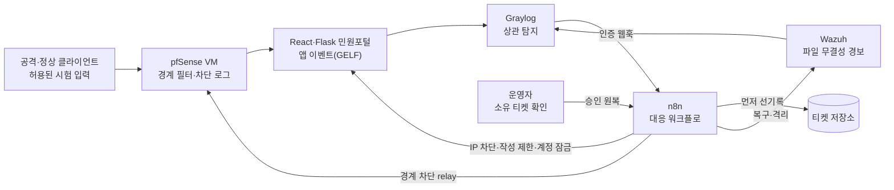

- **티켓을 먼저 기록해야 조치합니다.** 기록에 실패하면 조치하지 않고 보류합니다.
- **효과로 판정합니다.** 차단 API의 200이 아니라 재조회한 실제 상태와 클라이언트 응답을 확인합니다.
- **정확한 소유 티켓으로만 원복합니다.** 다른 사건이나 다른 봇이 소유한 조치는 풀지 않습니다.
- **비밀값은 Git과 증적 밖에 둡니다.** 키·비밀번호는 Git 제외 `.env`/`.local`과 stdin으로만 다룹니다.

## 개인 랩 구성

<table>
<tr>
<td width="50%">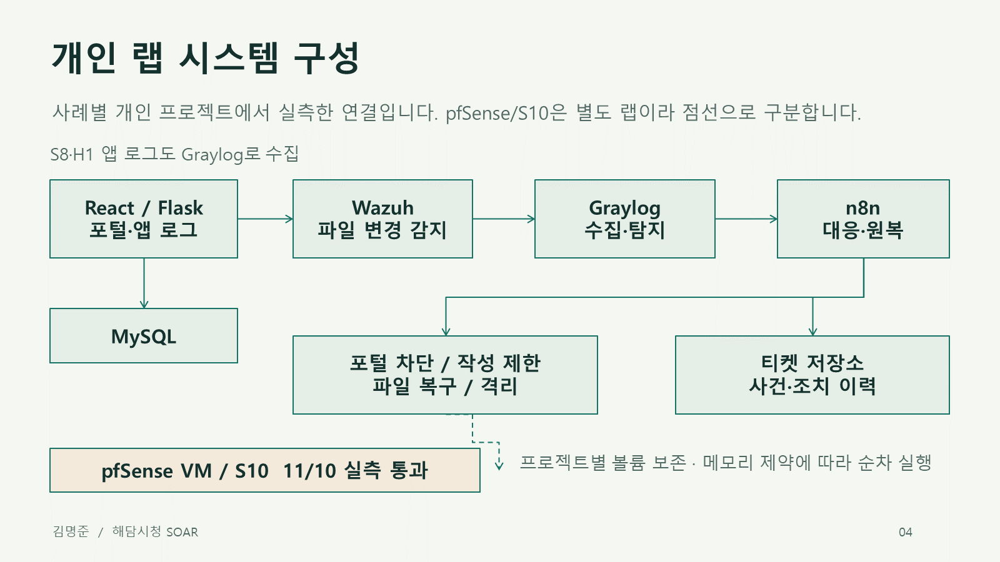<br><sub>사례별 개인 Docker 프로젝트로 실측한 연결. pfSense/S10은 별도 랩입니다.</sub></td>
<td width="50%">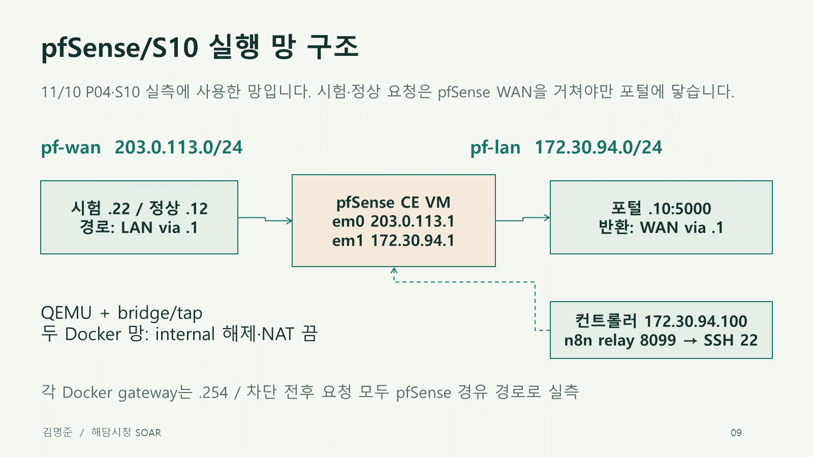<br><sub>공격·정상 요청이 pfSense WAN을 거쳐야만 포털에 닿는 S10 실행 망.</sub></td>
</tr>
</table>

- **환경:** Windows 11, Docker Desktop(약 6GiB), KVM 없음. 메모리가 작아 랩을 하나씩 실행하고, 실측 동안 기존 학원 스택을 멈췄다가 복원했습니다.
- **pfSense:** CE 2.7.2를 컨테이너 안 QEMU VM(소프트웨어 에뮬레이션)으로 띄웠습니다. n8n은 고정 호스트 키 SSH relay로 팀 pfSense 제한 도구만 호출합니다.
- **설정:** 주소·포트·경로는 `infra/*-settings.json`, 비밀값은 Git 밖 `.env*`에서 읽습니다. 게시 포트는 모두 `127.0.0.1`입니다.


## 실제 화면

<table>
<tr>
<td width="50%">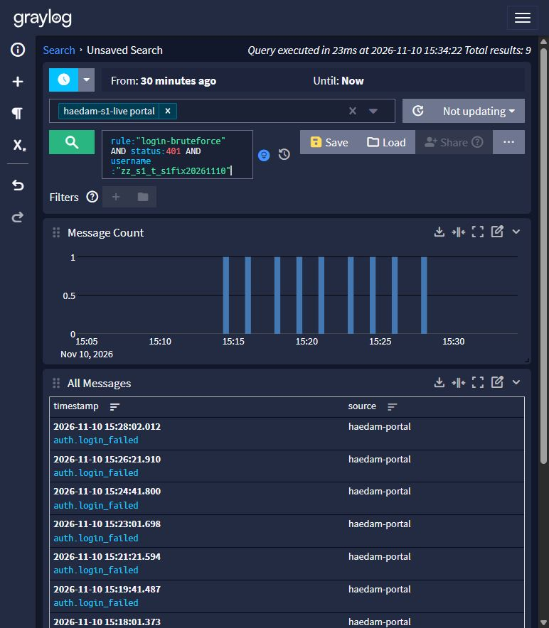<br><sub><b>S1</b> · Graylog에서 같은 합성 계정의 실제 로그인 실패 9건(100초 간격)</sub></td>
<td width="50%">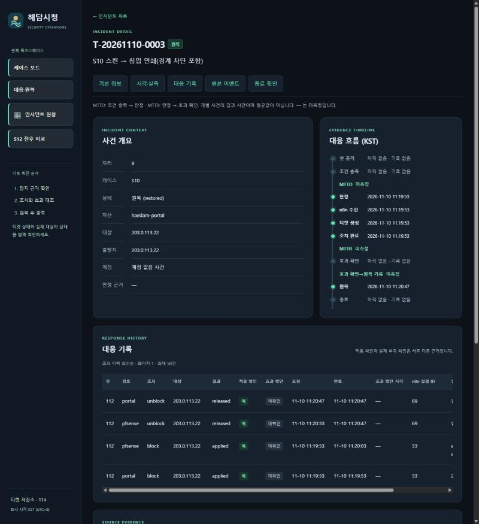<br><sub><b>S10</b> · 티켓 T-20261110-0003: 포털·pfSense 차단과 해제 기록, 상태 restored</sub></td>
</tr>
<tr>
<td>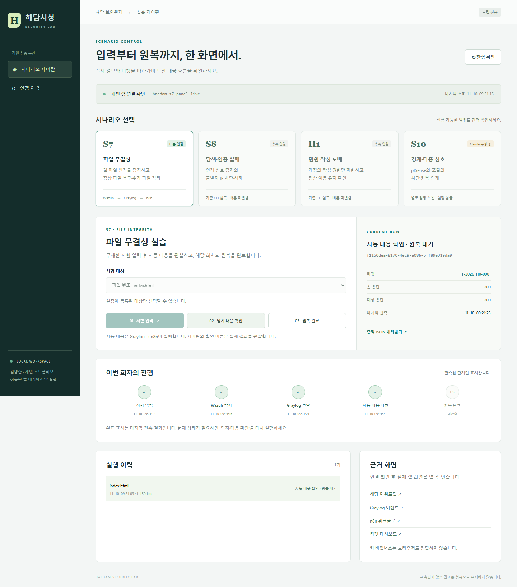<br><sub><b>S7</b> · 개인 실습 제어판: 시험 입력 → Wazuh → Graylog → 자동 대응·티켓(11/10 오전 캡처)</sub></td>
<td>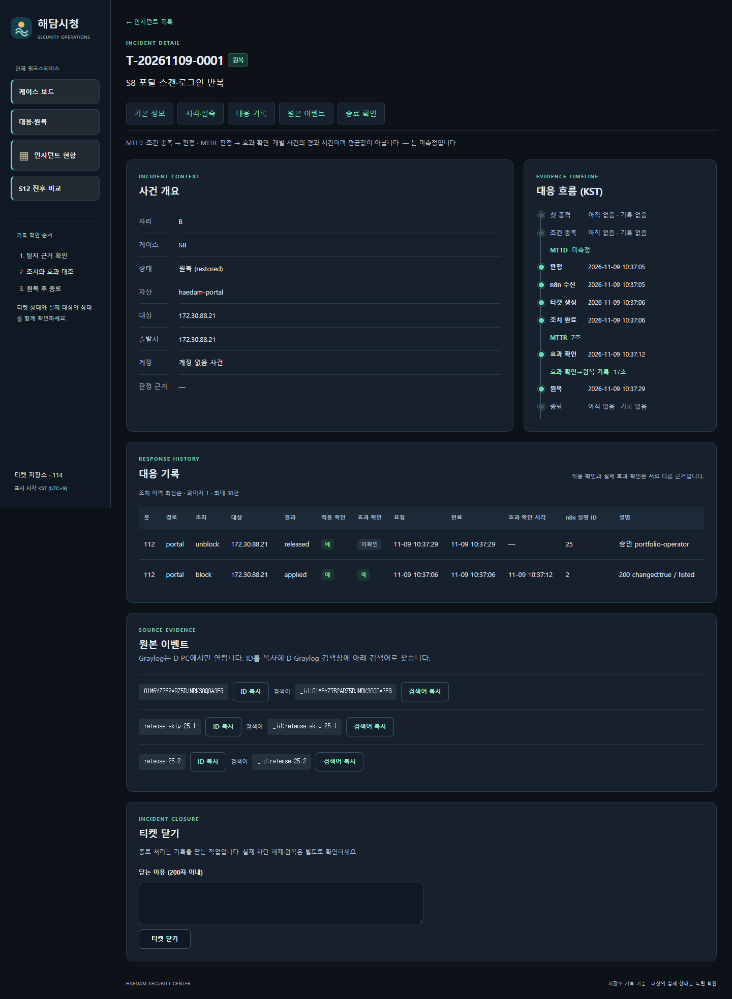<br><sub><b>S8</b> · 티켓 T-20261109-0001: 차단 applied → 승인 해제 released</sub></td>
</tr>
<tr>
<td>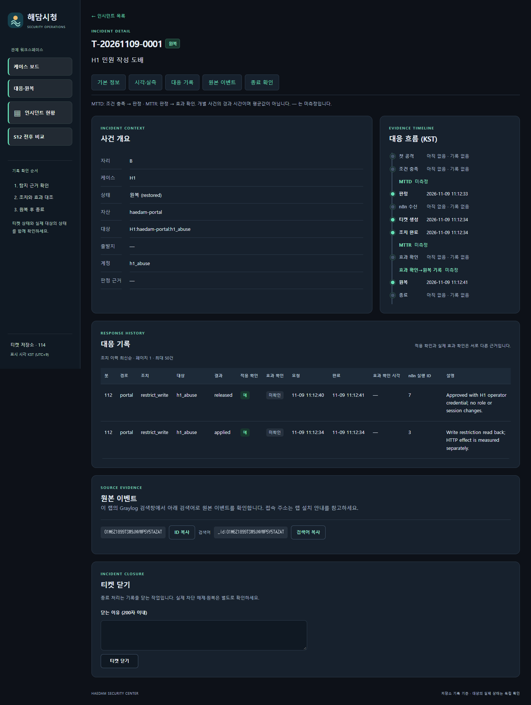<br><sub><b>H1</b> · 티켓 T-20261109-0001: 작성 제한 applied → 승인 해제 released, 상태 restored</sub></td>
<td>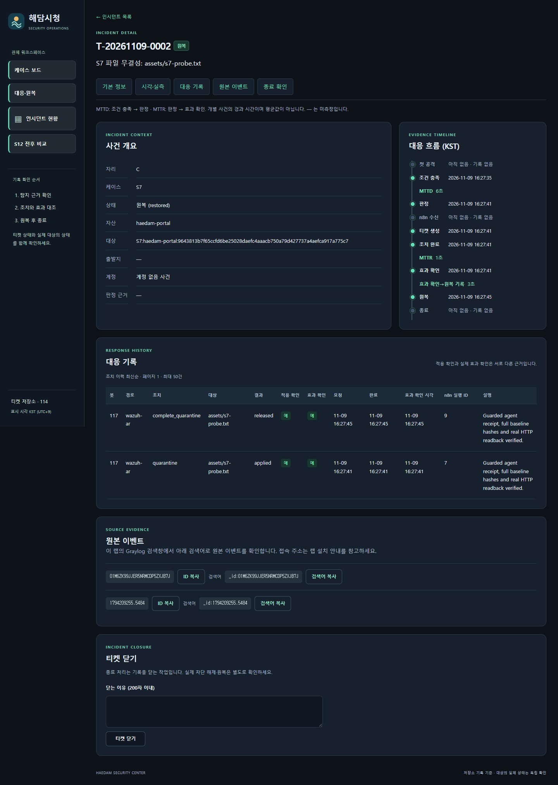<br><sub><b>S7 자동</b> · 티켓 T-20261109-0002: Wazuh 경보로 시험 파일 격리 → 원복 완료, 상태 restored</sub></td>
</tr>
<tr>
<td>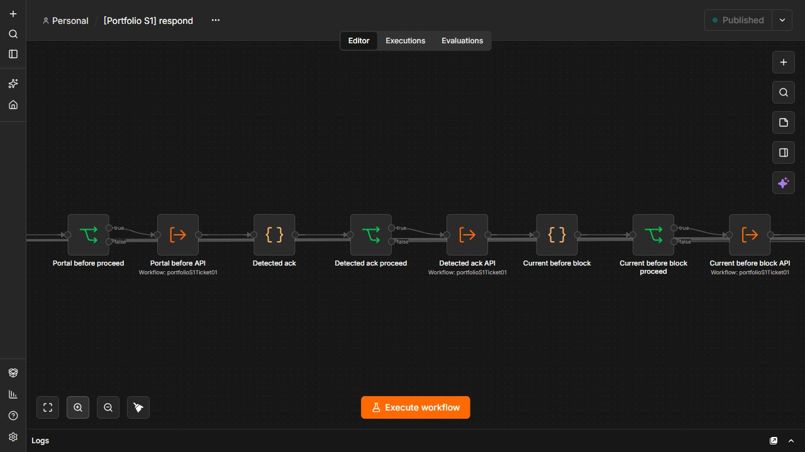<br><sub><b>n8n</b> · S1 대응 워크플로(실측 당시 캔버스). 현재 생성물은 여러 단으로 펼쳐 배치합니다.</sub></td>
<td>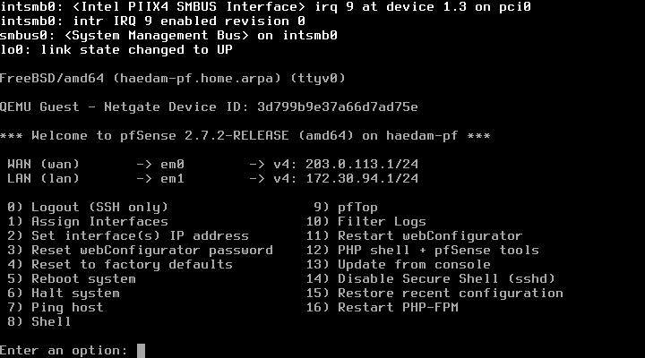<br><sub><b>pfSense</b> · Docker 안 QEMU VM으로 부팅한 pfSense CE 2.7.2(WAN 203.0.113.1, LAN 172.30.94.1)</sub></td>
</tr>
</table>

## 팀과 역할

| 팀원 | 담당 |
| --- | --- |
| **김명준** (@myeongjundev) | 조장·B. React·Flask 민원포털, S8·S10 시험 입력과 검증, pfSense 경계 대응·원복 검증 |
| 반소람 (@whiteclover0542) | A. S1·S4 계정 공격과 대응 검증 |
| 김상혁 (@shk12170-dev) | C. S7 파일 무결성, Wazuh, 티켓 저장소 |
| 김대훈 (@chacha1650a) | D. S12 가용성, Graylog·n8n 관제 연동 |

개인 전환에서는 팀 PC 두 대에 나뉘어 있던 구성을 한 대에서 새 볼륨으로 다시 설치하고, S8·H1·S7·P04/S10·S1을 실제 요청으로 재현했습니다. H1은 반소람 님의 시청 업무 보안 제안을 개인 환경에 구현한 추가 사례입니다.

## 설치와 실행

### 받기

최종 제출 대상은 **`main` 브랜치**입니다. **11/11 점검 시 S4 실측 수정(PR #30)과 S12·PPT r7(PR #31)은 아직 미병합**이므로, 검토 중인 최신 후보를 재현하려면 아래 후보 브랜치를 받습니다. 김명준이 #30 → #31 순으로 병합한 뒤에는 `--branch main`으로 바꾸고 해당 결과·PPT 파일이 있는지 확인합니다. 비공개 저장소 접근 권한이 있는 GitHub 계정으로 Git 인증을 준비합니다. 다른 작업 폴더가 있으면 새 빈 폴더에서 실행합니다.

```powershell
git clone --single-branch --branch codex/s12-personal-live https://github.com/myeongjundev/haedam-soar-portfolio.git
Set-Location haedam-soar-portfolio
git branch --show-current
git rev-parse --short HEAD
```

Windows 개인 랩은 PowerShell 7, Git, Docker Desktop의 Linux 컨테이너 엔진, Docker Compose **2.24.4 이상**, Python **3.12와 `py` 실행기**를 사용합니다. 첫 빌드에는 이미지·잠금 의존성을 받을 인터넷 연결이 필요합니다. 호스트 Node.js와 MySQL은 Docker 설치에 필요하지 않습니다. 아래 명령은 저장소 루트 기준입니다.

```powershell
$PSVersionTable.PSVersion
git --version
py -3.12 --version
docker version
docker compose version
docker info --format '{{.OSType}} / memory bytes={{.MemTotal}}'
docker ps --format '{{.Names}}'
```

`docker version`에서 Server에 연결되지 않으면 설치를 계속하지 않습니다. 도구의 `init`도 S7에서는 인증서·비밀번호 해시 생성용 컨테이너를 실행합니다. 다른 실측 중에는 S7 초기화를 포함해 순서를 조율합니다. 이 PC의 약 6GiB Docker 환경에서는 랩을 하나씩 실행하며 `stop`은 원복을 대신하지 않습니다. [설치 순서·환경 파일·정지 및 재개](docs/installation-guide.md)를 먼저 확인합니다.

### 포털과 DB

```powershell
if (-not (Test-Path .env)) {
  Copy-Item .env.example .env
  $rootSecret = [Convert]::ToHexString([Security.Cryptography.RandomNumberGenerator]::GetBytes(24))
  $appSecret = [Convert]::ToHexString([Security.Cryptography.RandomNumberGenerator]::GetBytes(24))
  @("MYSQL_ROOT_PASSWORD=$rootSecret", "MYSQL_PASSWORD=$appSecret", "PORTAL_PORT=15000") |
    Set-Content -Encoding utf8NoBOM .env
}
docker compose config --quiet
docker compose up -d --build --wait
docker compose ps
curl.exe --fail http://127.0.0.1:15000/api/v1/health
```

Linux에서는 최초 실행 전에 아래 명령으로 같은 형식의 `.env`를 만든 다음 Compose 명령을 실행합니다.

```sh
if [ ! -f .env ]; then
  (umask 077; printf 'MYSQL_ROOT_PASSWORD=%s\nMYSQL_PASSWORD=%s\nPORTAL_PORT=15000\n' \
    "$(openssl rand -hex 24)" "$(openssl rand -hex 24)" > .env)
fi
```

- 포털은 `http://127.0.0.1:15000`에서 열립니다. MySQL만 시작하려면 `docker compose up -d --wait db`를 사용합니다. MySQL 포트는 Compose 내부에서 접근합니다.
- 새 DB에서는 포털 기동 시 Alembic 마이그레이션을 적용합니다. 시민은 화면에서 가입할 수 있습니다. 관리자는 `docker compose exec portal flask --app haedam_portal:create_app create-admin`으로 합성 계정을 만듭니다.
- `docker compose stop`으로 멈추고 `docker compose up -d --wait`로 다시 실행하면 DB와 포털 이벤트 볼륨을 재사용합니다.
- 이미 초기화된 볼륨은 최초 MySQL 비밀번호를 사용합니다. 환경값을 직접 넣을 때는 DB URL에 쓸 수 있는 16진수 값을 사용합니다.

포털 화면·API·DB·규칙을 수정할 위치와 확인 방법은 [변경 후 재검증](docs/portfolio-plan.md#변경-후-재검증)에 있습니다. [개인 관제 Docker 설치](docs/docker-soc.md)를 따르면 포털과 MySQL에 Graylog·MongoDB·OpenSearch·n8n·티켓 저장소를 추가할 수 있습니다. `compose.team.yaml`과 [팀 규칙·워크플로](docs/sources.md#반입-경로)는 출처와 시나리오 설정을 확인할 때 사용합니다.

### 사례별 랩

각 사례는 별도 Docker 프로젝트·포트·볼륨을 사용합니다. 메모리가 작은 PC에서는 하나씩 실행하고, 도구는 다른 프로젝트를 자동으로 멈추지 않습니다.

<details>
<summary><b>S8</b> · 웹 탐색·로그인 반복 → 포털 IP 차단·티켓·원복</summary>

[S8 개인 랩 설치와 실측](docs/s8-lab.md)은 별도 프로젝트 `haedam-s8-live`에 필요한 워크플로와 자격증명, 실제 Graylog 스트림·알림을 연결합니다. 공격·정상 클라이언트를 별도 컨테이너로 두고 실제 포털 404·로그인 실패 401 → 탐지 → IP 차단 403 → 티켓 검증 → 원복 200을 시험합니다.

```powershell
py -3.12 tools/s8_lab.py init
py -3.12 tools/s8_lab.py up
py -3.12 tools/s8_lab.py configure
py -3.12 tools/s8_verify.py
py -3.12 tools/s8_lab.py stop
```

P01/P02와 S8은 포털 기본 포트가 같으므로 번갈아 실행합니다. 실제 차단 대상은 개인 랩 IP 하나이며, [원복 인증과 티켓 계약](docs/s8-contract.md)을 따릅니다.

</details>

<details>
<summary><b>H1</b> · 민원 도배 → 작성 권한만 일시 제한·원복</summary>

[H1 개인 랩](docs/h1-lab.md)은 실제 민원 등록 → 계정별 Graylog 탐지 → n8n 작성 제한·티켓 → 운영자 해제를 연결합니다. 제한 중에도 로그인·기존 민원 조회와 다른 시민의 작성은 유지합니다. 임계값은 합성 랩 기준이며 운영 기준으로 확정한 값이 아닙니다.

```powershell
py -3.12 tools/h1_lab.py init
py -3.12 tools/h1_lab.py up
py -3.12 tools/h1_lab.py configure
py -3.12 tools/h1_verify.py
py -3.12 tools/h1_lab.py stop
```

[H1 실측 결과](docs/h1-results.md) · [H1 계약](docs/h1-contract.md) · [검토 카드](docs/h1-review.md) · 제한 쪽 부분 실패는 `tools/h1_control.py reconcile`로 정합합니다.

</details>

<details>
<summary><b>S7</b> · Wazuh 파일 변조 탐지와 복구(수동 랩)</summary>

[S7 개인 Docker 설치](docs/s7-lab.md)는 Wazuh manager·indexer·dashboard와 실제 포털 웹 파일을 감시하는 agent를 새 포털·MySQL과 함께 구성합니다. 변조 경보 검색과 Wazuh API 복구·격리, HTTP·해시 원복을 검증합니다. 자동 복구·티켓·제어판을 검사하려면 이 수동 랩 없이 아래 **S7 자동 연결**로 바로 진행합니다. 두 S7 프로젝트를 동시에 기동하지 않습니다.

```powershell
py -3.12 tools/s7_lab.py init
py -3.12 tools/s7_lab.py up
py -3.12 tools/s7_lab.py ready
py -3.12 tools/s7_lab.py baseline
py -3.12 tools/s7_verify.py
```

[S7 결과와 남은 범위](docs/s7-results.md) · [Claude 검토 카드](docs/s7-review.md) · [프론트·백엔드 파일과 앱 로그 감시](docs/portal-wazuh-paths.md)(`ready` 이후 `py -3.12 tools/s7_paths_verify.py`).

</details>

<details>
<summary><b>S7 자동</b> · Wazuh → Graylog → n8n 자동 복구·티켓</summary>

[S7 자동 연결 설치](docs/s7-auto-lab.md)는 실제 FIM 경보를 Graylog·n8n으로 전달하고 티켓 선기록 → 자동 복구/격리 → 파일·HTTP 효과 확인 → 운영자 원복 완료까지 연결합니다. [새 볼륨 실측](docs/s7-auto-results.md)에서 정상·중복·기록 장애·재시도·원복을 확인했습니다. 팀의 접근 성공 상관 정책과 구분한 개인 FIM 정책입니다.

```powershell
# 제어판과 같은 프로젝트·감시 설정을 선택합니다.
$panelConfigPath = if ($env:PANEL_CONFIG_FILE) { $env:PANEL_CONFIG_FILE } else { 'infra/panel-settings.json' }
$panelSettings = Get-Content -LiteralPath $panelConfigPath -Raw | ConvertFrom-Json
$env:S7_PROJECT = $panelSettings.s7_project
$env:S7_CONFIG_FILE = $panelSettings.s7_settings
py -3.12 tools/s7_auto_lab.py init
py -3.12 tools/s7_auto_lab.py up
py -3.12 tools/s7_auto_lab.py ready
py -3.12 tools/s7_auto_lab.py configure
py -3.12 tools/s7_auto_verify.py
py -3.12 tools/s7_auto_failures.py
py -3.12 tools/s7_auto_lab.py stop
```

Compose 2.24.4 이상이 필요합니다. 비밀값은 `.env.s7-auto`, 연결·감시 환경값은 [공통 설정](infra/s7-auto-settings.json)에서 관리합니다. [계약](docs/s7-auto-contract.md) · [Claude 검토 카드](docs/s7-auto-review.md). 마지막 `stop` 이후 버튼 검사를 계속하려면 같은 설정을 선택한 터미널에서 `up`과 `ready`를 다시 실행하고 제어판을 켭니다. 새 PowerShell 창에서는 위 설정 선택 네 줄도 다시 실행합니다.

</details>

<details>
<summary><b>제어판</b> · 버튼으로 실행하는 개인 실습 제어판</summary>

```powershell
py -3.12 tools/panel.py
```

기본 `http://127.0.0.1:15800`에서 **환경 확인 → S7 시험 입력 → 탐지·대응 확인 → 원복 완료**를 실행합니다. 허용된 개인 랩만 대상으로 하며 Docker/VM을 켜거나 끄지 않습니다. S7 랩은 별도로 준비해야 합니다. S8/H1은 버튼 미연결, S10은 CLI 실측은 통과했지만 버튼은 연결하지 않아 실행 잠금으로 표시합니다. [설치·설정·검증 범위](docs/panel-lab.md) · [API 계약](docs/panel-contract.md) · [실측 결과와 캡처](docs/panel-results-20261110.md).

</details>

<details>
<summary><b>P04·S10</b> · pfSense 경계 차단·포털 차단·원복</summary>

[P04·S10 개인 랩](docs/s10-lab.md)은 pfSense CE 2.7.2를 Docker 컨테이너 안의 QEMU VM(KVM 없음, 소프트웨어 에뮬레이션)으로 띄웁니다. 공격·정상 클라이언트의 실제 요청이 pfSense를 거쳐 포털에 닿습니다. S10은 pfSense ICMP 차단 로그, 포털 404, 포털 401 세 신호를 모아 Graylog 상관 탐지 → n8n 티켓 선기록 → 포털 IP 차단과 pfSense 차단 → 운영자 원복으로 이어집니다.

```powershell
$iso = Read-Host 'pfSense CE 2.7.2 ISO 파일 경로'
py -3.12 tools/pf_lab.py init --iso $iso
py -3.12 tools/pf_lab.py up pfsense        # 최초 1회 설치는 docs/s10-lab.md 순서
py -3.12 tools/pf_verify.py                # P04: 경계 차단·정상 유지·원복
py -3.12 tools/s10_lab.py init
py -3.12 tools/s10_lab.py up
py -3.12 tools/s10_lab.py pfsense
py -3.12 tools/s10_lab.py configure
py -3.12 tools/s10_verify.py               # S10 실제 경로
py -3.12 tools/s10_failures.py             # 티켓 저장소·relay 장애
```

pfSense ISO는 Git에 넣지 않습니다. 실행 중에는 기존 관제 스택을 멈춥니다. 시험 대상은 팀 도구가 허용하는 개인 랩 출발지 하나입니다. [실측 결과](docs/s10-results-20261110.md) · [인수인계](docs/s10-handoff-20261110.md).

</details>

<details>
<summary><b>S1·S4</b> · 계정 공격 탐지(S1·S4 실측 통과)</summary>

- **S1** — [개인 설정·입력 도구](docs/s1-personal-prep.md)(8회/9회 제한 입력, 기본은 계획 출력), [자동 대응·원복 워크플로](docs/s1-auto-workflows.md), [실제 실측 절차](docs/s1-live-preparation.md), [실측 결과와 화면](docs/s1-results.md). 실제 9회 로그인 실패 → Graylog → n8n → 공격 출발지 200→403→200, 정상 계정 로그인 유지, 티켓 restored·활성 조치 0을 확인했습니다. 첫 회차에서는 하위 워크플로의 반환이 빠져 빈 HTTP 200이 나왔고, 이를 고친 뒤 다시 측정했습니다.
- **S4** — [계정 잠금·원복 워크플로](docs/s4-auto-workflows.md), [실제 입력 준비](docs/s4-live-preparation.md)(6개 입력 유형), [세션·증적 도구](docs/s4-session-evidence.md). 11/10 새 개인 랩에서 경계 5건 무탐지, 6건 탐지→계정 잠금·세션 회수→티켓·원복을 확인했습니다. [실측 결과와 최초 실패 수정](docs/s4-results.md).
- [S1·S4·S12 개인 재실측 준비](docs/s1-s4-s12-rehearsal-plan.md) · [PR #17·#18 인계 검토](docs/s1-s4-review-20261110.md).

</details>

<details>
<summary><b>S12</b> · 요청 증가와 서비스 지연 확인 후 차단·원복</summary>

S12는 [개인 설치·기준선·차단·원복 절차](docs/s12-lab.md)를 따릅니다. 새 번들에서 기준선을 측정한 뒤 탐지·health 조건을 설정하며, 기본 미측정 설정은 실행 비활성입니다. [통제된 자원 경합 실측 결과](docs/s12-results.md)를 운영 DDoS 성능 검증으로 확대하지 않습니다.

</details>

## 제출물과 문서

| 항목 | 위치 |
| --- | --- |
| 개인 포트폴리오 PPT | [r7 PPTX 34장](output/portfolio/김명준-해담시청-SOAR-개인포트폴리오-20261111-r7.pptx) · [편집 원본·출처·검증](docs/portfolio/README.md) |
| 제출 자료 묶음 | [11/11 제출 ZIP](output/submission/김명준-개인포트폴리오-제출자료-20261111.zip) — 동일 PPT·제출 안내·지원 문안·검증 요약·해시 목록 |
| 과제 검증표 | [개인 설치·실측 상태](docs/portfolio-plan.md) |
| 제출 준비 | [11/11 최종 후보·남은 확인](docs/submission-readiness-20261111.md) |
| 설치 점검 | [11/11 새 clone 점검](docs/installation-audit-20261111.md) · [이전 점검](docs/installation-audit-20261110.md) · [설치 순서](docs/installation-guide.md) |
| 출처와 기여 | [팀 원본 기준 커밋·팀원별 출처](docs/sources.md) |
| 이력서·자기소개서 문안 | [프로젝트 문안과 근거](docs/application-materials.md) |

PPT에는 플로우차트, 상세 아키텍처, Docker·pfSense 망 구조, 포트 구성, 사례별 실측(S8·S7·H1·S10·S1·S4·S12), n8n 노드 연결도와 실제 화면, Graylog·Wazuh 경보 증적·실제 관제 화면, 제어판 화면과 개선 방향을 담았습니다.

## 한계와 다음 단계

- **S12는 통제된 자원 경합 시험입니다.** 11/11 요청 증가와 실제 health 지연을 함께 확인해 차단·티켓·원복을 실측했습니다. 운영 DDoS 방어 성능이나 지속 공격 중 처리량 검증으로 확대하지 않습니다. [개인 설치·실행](docs/s12-lab.md), [결과와 한계](docs/s12-results.md).
- **새 clone 전체 기동 재현은 오프라인 점검까지입니다.** 설치·시험·Compose 설정 해석은 통과했지만, 최종 버전을 새 clone에서 실제로 띄워 다섯 구성을 다시 확인하지는 않았습니다.
- **티켓의 효과 확인·MTTD/MTTR은 비어 있습니다.** 실제 효과는 검증기의 클라이언트 요청으로 확인했고, 외부 Discord 알림은 보내지 않았습니다.
- **수치는 1회 관측값입니다.** 반복 측정, 임계값 기준선, Graylog 알림 재시도·n8n 중단 같은 남은 장애 실측은 개선 과제입니다.
- **부분 실패 복구는 운영자 명령 중심입니다.** 기록 재시도 큐와 상태 대조 자동화가 다음 단계입니다.

## 작업 방식

[공통 작업 규칙](AGENTS.md)과 [과제 검증표](docs/portfolio-plan.md)를 따라 작업별 PR을 열고, 개인 작업일지(`work-log/members/myeongjundev/`)에 실제 확인 결과와 미검증 부분을 기록했습니다. 개인 전환 작업은 AI 코딩 도구를 함께 사용했습니다. Codex는 구현·재현·자료 정리를, Claude는 독립 검토·실패 분석·pfSense/S10 작업을 맡았고, 범위 결정과 결과 확인, 병합은 김명준이 했습니다. 같은 GitHub 계정의 PR 코멘트는 다른 사람의 승인으로 표시하지 않습니다. 새 작업은 [첫 문제 해결 카드](docs/claude-first-task.md)에서 시작합니다.

최신 제출 목표는 **2026-11-11 수요일 오전(KST)**입니다. 11/11 사용자 지시로 이전 17:30 계획을 앞당겼습니다.
