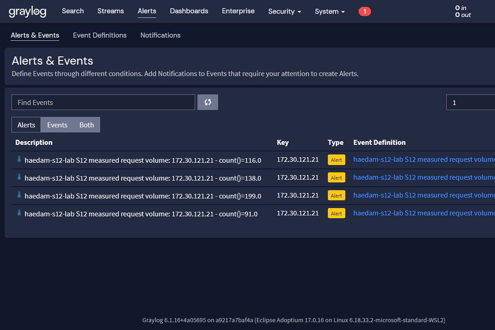
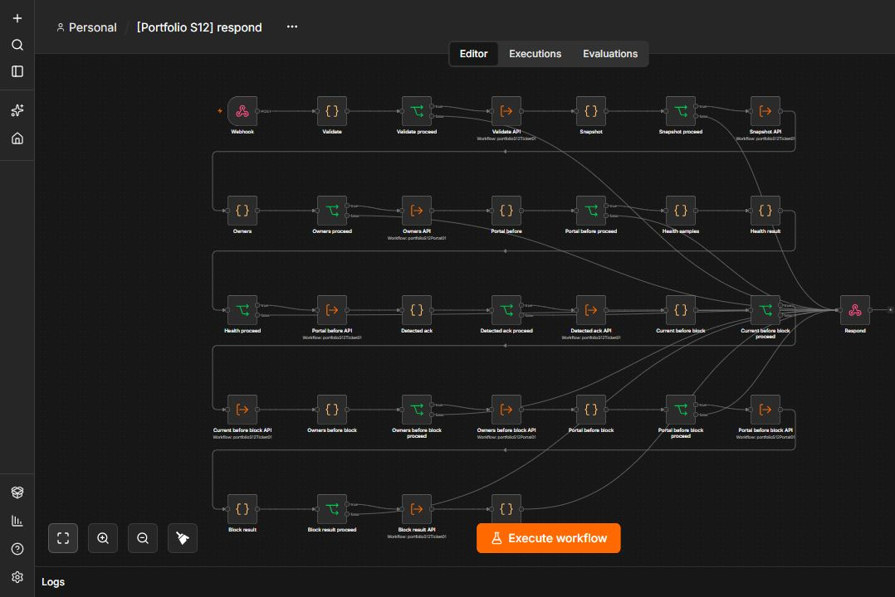
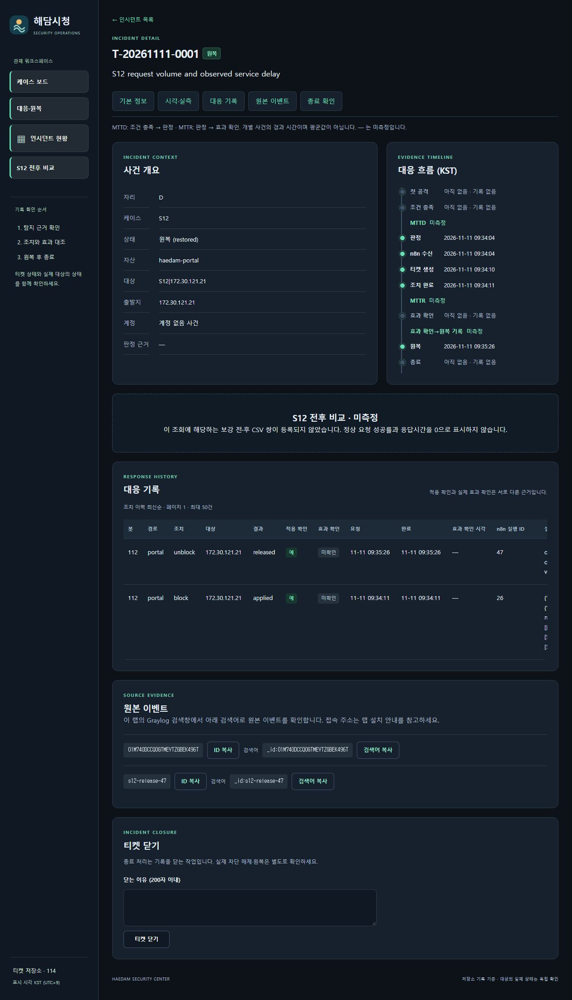

# S12 개인 자원 경합·차단·원복 실측

2026-11-11 김명준·Codex. **격리된 포털의 통제된 자원 경합 조건에서 Graylog → n8n → IP 차단·티켓 생성 → 정상 경로 회복 → 같은 티켓 원복을 확인했습니다.** 실행 `s12control20261111`, 티켓 `T-20261111-0001`, Graylog 이벤트 `01M740DCCQ0GTMEVTZGBEK496T`입니다. 운영 환경 DDoS 방어 성능을 측정한 결과는 아닙니다.

[공개 증적 JSON](evidence/s12-live-20261111.json) · [설치·재현 명령](s12-lab.md) · [작업 범위](s12-task.md) · [출처](sources.md)

| 항목 | 관측 결과 |
| --- | --- |
| 정상 기준선 | 공격/정상 출발지 각각 31회, Graylog 고유 수신 각각 31건. n8n 실제 경로 30회 정상, p95 10ms |
| 확정 정책 | 요청 count > 90 / 60초, 평가 30초, 알림 유예 60초. n8n health > 310ms 연속 3회, 2초 간격 |
| 기준 이하 | 3건 뒤 90초 무탐지·무티켓. 정확한 N/N+1 실측은 아님 |
| 서비스 정상 대조 | 231건 요청, Graylog 탐지 발생, 티켓/차단 0. 정상 요청 100/100 성공 |
| 저하 입력 | 단계별 2→5→5회/초 설정, 동시성 2, 90초/240건 상한. 차단 관측으로 142건에서 중지, Graylog 원천 142건 일치 |
| 실제 탐지 창 | 같은 공격 IP의 web.request 116건, 이벤트와 원천 시간창 일치 |
| health 저하 | 실제 n8n→포털 응답 509 / 526 / 524ms, 모두 200/정상 본문이나 기준 310ms 초과 |
| 요청 수 기준→탐지 | **17.966초** |
| 요청 수 기준→차단 API 완료 | **24.704초** (탐지→차단 6.738초, health 검사 포함) |
| 공격 효과 | 200 → 403 IP_BLOCKED → 승인 원복 후 200 |
| 정상 대조 | config 경로 100/100 정상 본문·200. 저하 중 p95 510.8ms, 실패 0 |
| 회복 | 차단 직후 처리 중이던 요청 영향으로 정상 1건 509.325ms. 09:34:12.603 KST부터 후속 43건 기준 이내. n8n 재확인 7/7/7ms |
| 회복 시점 | 경합 자동 만료 전 확인. 차단 관측 후 입력 중지와 함께 회복한 결과이며 지속적인 대규모 공격 차단 성능을 증명하지 않음 |
| 원복 | n8n 실행 47, 같은 티켓 restored. 양쪽 probe 각 3회 모두 200/정상 본문 |
| 직접 감사 | 포털 활성 IP 차단 0, 티켓 DB 활성 조치 0, n8n 활성 실행·실행 payload 0 |
| 가드 | 동일 이벤트 추가 차단 없음, 다른 티켓 원복 409, 키 없음 403, 유효 키/잘못된 본문 400 |

요청 기준 충족 시각은 서버 원천 로그의 최초 91번째 유효 요청 `09:33:46.345 KST`입니다. Graylog 처리 `09:34:04.311`, 차단 API 완료 `09:34:11.049`와 대조했습니다. health의 세 번 연속 저하는 그 이후 별도 조건입니다. 따라서 위 시간을 모든 조건 충족 이후의 지연이나 클라이언트 효과 관측 시간으로 해석하지 않습니다. 한 회차 관측값이며 평균이나 보장 수치가 아닙니다.

## 시험 조건과 구현 차이

전용 `haedam-s12-lab` 프로젝트/빈 볼륨에 9개 서비스를 설치했습니다. 앞선 기준선·정상 대조 후 같은 랩을 재개해 저하 시험을 진행했습니다. 공유 슬롯 1개에 랩 전용 요청이 500ms씩 머무르도록 했고 최대 150초 후 자동 만료합니다. 실제 health 응답을 조작하지 않았습니다. 대응 API는 경합에서 제외하며 실제 IP 차단 가드가 랩 경합 처리보다 먼저 실행됩니다. 이 래퍼는 개인 랩에만 마운트하고 운영 포털 소스는 변경하지 않았습니다.

최초 정상 대조는 1→2→5회/초였고, 저하 시험은 탐지/health 관찰 시간을 확보하기 위해 초기 단계를 2회/초로 조정했습니다. 최대 속도·동시성·시간·건수 및 실측 탐지 기준은 유지했습니다. 설정 원본과 각 단계 설정을 로컬에 보존했고 공개 JSON에는 실제 저하 시험 설정을 포함했습니다.

팀 김대훈의 S12 정책과 기준선 계산식을 사용했습니다. 김명준·Codex의 개인 추가는 설정/배포 생성, 분리된 키, 실제 출발지 입력, 현재 티켓·IP 소유권 확인, 랩 경합 조건, 정상 대조/원복 증적입니다. S1의 검토된 티켓·포털 하위 흐름을 재사용하고 S12의 health 판정은 별도로 구현했습니다.

## 실제 화면

첫 행 116건이 저하 시험이며 아래 행은 서비스 정상 상태의 요청 수 초과 대조입니다. 화면의 이벤트 시각과 `timestamp_processing`은 다른 필드입니다.

이 이미지는 실제 게시된 노드 구성 화면입니다. 실행 성공 자체는 동일 이벤트 ID·n8n 실행 26/47·티켓 조치·클라이언트 증적으로 확인했습니다.

티켓의 `effect_verified`, 대시보드 MTTD/MTTR 및 S12 전후 CSV 화면은 미측정 상태를 유지합니다. 외부 JSON probe로 효과를 확인했으며 UI 값을 임의로 채우지 않았습니다. 정상 대조는 config/health GET이며 실제 시민의 로그인·민원 작성 업무 전체 검증은 아닙니다.

## 종료와 검증 상태

09:42 KST 기존 Graylog·Wazuh 6개를 원래 ID로 재개하고 두 대시보드 HTTP 200, Wazuh 핵심 프로세스, MySQL TCP·ID/시작 시각, VM 프로세스 ID/시작 시각 유지까지 확인했습니다. S12 9개는 정지했고 볼륨은 보존했습니다. Wazuh 대시보드는 재기동 직후 준비 중이어서 재확인 후 200을 확인했습니다.

최종 호스트 검사 241개·하위 검사 125개 통과, S12 신규 11개 포함. 실제 controlled/recover는 저장소 CLI로 실행했습니다. 최초 configure/baseline은 같은 핵심 로직의 로컬 스크립트로 실행했으므로, 정리된 CLI 전체를 새 PC에서 처음부터 다시 실행한 검증과 구분합니다. 실측 뒤 원복 검사기에 ‘여전히 403인 클라이언트’와 비정상 health를 거부하는 단정을 추가하고 부정 테스트를 통과시켰습니다. 공개 JSON의 실측 소스 해시와 최종 커밋의 차이는 이 검사 강화에 해당하며 실제 응답 워크플로는 바꾸지 않았습니다.
