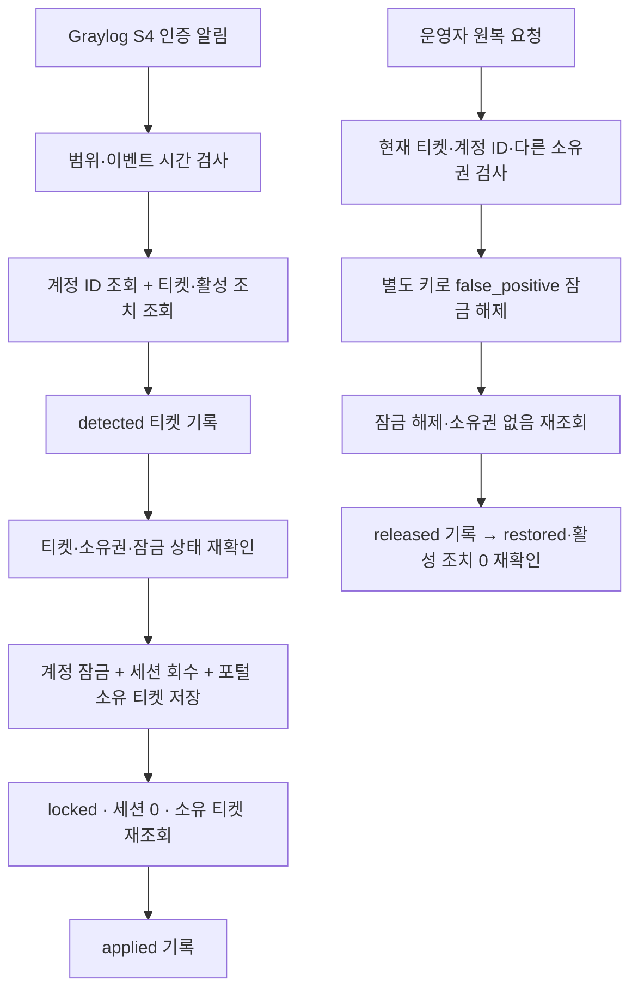

# S4 개인 계정 잠금·티켓·원복 — 오프라인 구현

2026-11-10 김명준·Codex 작업. 기준은 PR #18의 `40e180b`이며 S1 파일과 Claude의 S10 작업 폴더를 변경하지 않습니다. 팀 S4 탐지 기준과 티켓 워크플로를 바탕으로 개인 랩 전용 설정, 계정 소유권, 세션 회수 확인과 운영자 원복을 추가했습니다. **Docker·VM, Graylog·n8n에 배포하거나 실제 경보를 발생시키지 않았습니다.**

## 작업 경계와 인수 조건

- 중앙 설정으로 네트워크·포트·계정·연결 주소·자격증명 참조를 바꿉니다. 배포 주소나 사용자 비밀번호를 JS에 직접 적지 않습니다.
- Graylog 인증 알림 → 현재 계정 확인 → 티켓 선기록 → 계정 잠금·세션 회수 → 읽기 재확인 → 적용 기록을 연결합니다.
- 원복은 별도 운영자 인증, 현재 티켓, 계정 ID, 활성 조치, 포털의 소유 티켓을 대조한 뒤 오탐 해제합니다. 비밀번호 변경이나 기존 세션 복원은 하지 않습니다.
- 실패·중복·다른 소유 티켓·계정 재생성·DB 변경을 오프라인으로 검증합니다. 실제 엔진의 실행 순서, 웹훅 인증, MySQL 동시성, Graylog 집계는 실측 전 확인 대상으로 남깁니다.

## 설정과 산출물

| 파일 | 역할 |
| --- | --- |
| [s4-settings.json](../infra/s4-settings.json) | 개인 Compose 프로젝트, 후보 망·포트, 대상/정상 계정, 팀 집계 기준 |
| [s4-integration-settings.json](../infra/s4-integration-settings.json) | 연결 주소, 웹훅 경로, 인증 역할, 이벤트 유효 시간, 탐지 활성 여부 |
| [s4_lab.py](../tools/s4_lab.py) | 새 `.local` 폴더에 환경변수·Compose override·규칙·워크플로 생성. Docker/HTTP 호출 없음 |
| [build_s4_workflows.py](../tools/build_s4_workflows.py) | 팀 티켓 10번을 파생하고 S4 전용 계정·대응·원복 워크플로를 생성 |
| [S4 JS 원본](../infra/n8n/s4-src) | 제어 흐름과 계정 API 어댑터. 생성 JSON 대신 이 원본을 수정 |
| [생성 워크플로](../infra/n8n/portfolio-s4) / [Graylog 사양](../infra/graylog/portfolio-s4.json) | 비활성 JSON. 실제 입력·스트림·알림 ID와 자격증명은 포함하지 않음 |
| [연결 계약](s4-contract.md) | 포털 API·웹훅·티켓 필드와 원복 제한 |

기본 후보는 `haedam-s4-lab`, 망 `172.30.104.0/24`·`105.0/24`·`106.0/29`·`107.0/29`, 포털/Graylog/n8n/GELF/티켓 호스트 포트 `15070/19170/15770/22370/18170`입니다. **실행 중인 망·포트와의 충돌 여부는 아직 확인하지 않았습니다.** 네트워크는 모두 internal이며 포털의 대응 API는 전용 n8n 주소 `/32`만 허용합니다.

```powershell
# 저장소 루트, Python 3.12 이상. 아래 명령은 서비스에 접속하지 않습니다.
python tools/s4_lab.py check
python tools/s4_lab.py init --output .local/s4-prep
python tools/build_s4_workflows.py --check
```

`init`은 기존 `.env`를 읽지 않고 새 키를 생성하며 기존 출력 폴더를 덮어쓰지 않습니다. `lab.env`는 Git 제외 대상입니다. Windows에서는 파일 ACL도 본인만 읽도록 확인합니다. 번들의 `compose_argv`는 이후 배포할 때 사용할 인수 목록일 뿐 실행하지 않습니다. 기본 `execution_enabled=false`, `detection_enabled=false`, 워크플로 `active=false`입니다. 현재 S4 도구에는 공격 입력 실행 기능이나 배포 실행 명령이 없습니다.

인증 키는 탐지 웹훅 `S4_DETECTION_KEY`, 운영자 웹훅 `S4_OPERATOR_KEY`, 포털 조회/잠금 `PORTAL_RESPONSE_KEY`, 포털 해제 `S4_RELEASE_KEY`, 티켓 `TICKET_STORE_KEY`의 다섯 역할로 분리합니다. 생성 JSON에는 참조 ID만 들어갑니다. `materialize(settings, integration, bindings, secrets)`는 실제 Graylog input/index-set/stream/notification ID 네 개와 서로 다른 키 다섯 개를 검증해 import용 객체를 반환하는 순수 함수입니다. 반환값에는 비밀값이 있으므로 출력·커밋하지 않고 개인 `.local`에만 저장해야 합니다. 이 함수 역시 API를 호출하거나 가져오기를 실행하지 않습니다.

## 흐름과 중복 처리



Graylog는 **10분 이내 같은 username+src_ip에서 401 실패와 200 성공이 모두 존재하며 합계 6건 이상**이면 탐지합니다. 실패가 성공보다 먼저라는 순서를 보장하지 않으며 429는 제외합니다. 실패 1건+성공 5건도 발동하는 알려진 오탐 조건을 유지하므로 ‘실패 5회 이상’을 판정하는 규칙으로 설명하면 안 됩니다. 실행 간격 60초, 알림 유예 600초를 팀 기준 그대로 유지합니다. 입력은 개인 대상 계정과 개인 공격 출발지로 추가 제한합니다. 실제 배포 시 GELF source·rule·status·username·src_ip 필드도 확인해야 합니다.

티켓 그룹은 `S4|username`입니다. 계정 잠금은 IP와 관계없이 적용되므로 탐지 그룹과 티켓 소유권 그룹을 구분합니다. 조치 target은 `username:user_id`, bot은 `111`, via는 `portal`, action은 `lock/unlock`입니다. 계정 ID를 DB에서 읽어 결합하므로 같은 이름으로 새 계정을 만들어도 과거 티켓으로 해제하지 못합니다.

포털 `s4_account_claims`는 잠금·세션 회수·중복 영수증과 같은 DB 트랜잭션에 기록됩니다. 관리자 또는 일반 대응 API가 상태를 변경하면 이 S4 소유권은 같은 트랜잭션에서 제거됩니다. 이후 계정이 계속 잠겨 있으면 S4는 다른 담당의 잠금으로 보고 자동 해제를 거절합니다. SQL 직접 변경은 이 통제를 우회하므로 개인 랩에서도 대응 중 DB 직접 수정은 하지 않습니다.

같은 경보 재전달은 중복 대응하지 않습니다. 잠금 중 새 이벤트도 티켓에 기록하여 원복 후 재전달로 다시 잠그는 것을 방지합니다. 새 이벤트가 들어오면 새 티켓 회차를 만듭니다. 늦게 도착한 원복 요청은 최신 티켓과 일치해야 합니다. S4 워크플로 외부에서 동일 계정에 대응하는 작업은 직렬로 운영하며 번들은 n8n 동시 실행을 1로 제한합니다.

## 장애와 복구

- 티켓 조회·detected 기록 실패: 계정 변경 안 함.
- 기존 잠금 또는 다른 포털/티켓 소유권: 인계받은 것으로 추측하지 않고 중단.
- 잠금 응답 유실: 포털의 계정 ID·소유 티켓·잠금·세션 0을 다시 읽어 판단. 응답을 받았지만 재조회 실패이면 티켓에 미검증 적용을 남겨 원복 경로를 유지.
- 실제 잠금 후 applied 기록 실패: 자동 재잠금/해제하지 않고 `held_applied_record_reconcile`. Graylog를 멈추고 포털 소유 티켓과 해당 티켓 기록을 수동 대조하여 **같은 티켓의 실제 적용 증거**를 보완한 뒤 원복. 아무 티켓에 잠금을 붙이지 않음.
- 해제 후 released 기록 실패: 같은 티켓으로 재시도. 포털 Idempotency-Key가 동일하며 현재 해제 상태를 다시 조회한 후 기록.
- 잘못된 입력 400, 소유권·현재 상태 충돌 409, 저장소·재조회 실패 503. 실패를 완료로 표시하지 않음.

`applied_verified`는 포털 DB/API 상태를 확인한 결과입니다. 실제 브라우저 로그인 효과·탐지 시간은 따로 측정해야 하므로 워크플로의 `effect_verified`는 null로 유지합니다. 티켓 `restored`도 이 단계에서는 API 원복을 뜻하며 실제 n8n 실행 완료 증거가 아닙니다.

## 오프라인 검증과 남은 실측

```powershell
# 루트의 테스트 의존성(jsonschema, pytest, Flask 등)과 Node가 설치된 인터프리터/PATH 사용
python -m pytest tests/test_contracts.py tests/test_s4_contracts.py tests/test_s4_workflows.py -q
# 포털 의존성을 설치한 별도 .venv에서 실행; 외부 테스트 DB 환경변수는 사용하지 않음
cd haedam-portal-backend
python -m pytest tests/test_s4_accounts.py -q
```

그래프 검사는 생성된 Code/IF/하위 워크플로를 실행하고 HTTP를 메모리 모델로 대체합니다. 별도 테스트가 같은 요청 순서를 실제 Flask 포털·티켓 코드와 임시 SQLite에 재생합니다. 후속 [응답 계약 검토](s1-s4-review-20261110.md)에서 실제 저장소가 반환하지 않는 필드를 요구해 중복·원복이 중단되는 문제를 수정했습니다. 이제 포털 `tests/test_workflow_store_contract.py`가 실제 Flask 응답을 그래프에 직접 돌려주는 검사를 추가합니다. 포털 테스트는 이전 마이그레이션에서 새 버전으로 올라가도 기존 계정을 유지하는지 확인합니다. 이는 n8n 엔진·MySQL·Graylog 실제 연동 검증을 대신하지 않습니다.

실측 전 순서는 다음과 같습니다.

1. PR #17/#18과 이 S4 PR의 독립 리뷰 수정 사항을 통합합니다. 기존 작업을 종료하거나 환경을 바꾸기 전 사용자와 실행 순서를 맞춥니다.
2. 설정의 후보 망·포트·메모리를 확인하고 **새 프로젝트/볼륨**에서만 배포합니다. 포털 DB는 새 마이그레이션 `a640c2d1e910`까지 적용해야 합니다. 본 작업에서는 실행하지 않았습니다.
3. 개인 대상과 정상 계정을 생성합니다. 비밀번호는 로컬에서 입력하고 n8n·로그·Git·티켓에 저장하지 않습니다. 대상 세션 두 개와 정상 계정 세션을 준비합니다. S4 허용 목록에는 대상만 포함합니다.
4. Graylog 전용 입력/스트림과 실제 리소스 ID를 연결하고 인증 알림을 설정합니다. n8n 자격증명 다섯 개·하위 워크플로를 먼저 가져오고 웹훅을 등록합니다. 탐지는 비활성 상태로 입력 거부와 인증 실패부터 확인합니다.
5. 공격 도구를 실제 세션·CSRF 흐름으로 연결합니다(이번 범위에서는 미구현). 4실패+1성공은 경계 미탐지, 5실패+1성공은 탐지, 성공+5실패도 현재 규칙상 탐지, 성공만 6건/실패만 6건/계정·IP 혼합/429는 미탐지를 확인합니다. 경계 검사는 마지막 입력이 Graylog에 도착한 뒤 660초 이상 관찰합니다.
6. 대상의 신규 로그인 거부·기존 세션 무효, 정상 계정 로그인/기존 세션 유지, 티켓·포털 소유권을 같은 실행 ID로 대조합니다.
7. 원복 전에 Graylog 스케줄/알림을 멈추고 대기 실행을 확인합니다. 600초 검색창의 기존 입력이 만료될 때까지 재활성화하지 않습니다. 현재 티켓으로 운영자 해제 후 새 로그인 성공, 옛 세션 무효, 비밀번호 유지, 정상 사용자 영향 없음, 활성 조치 0을 확인합니다.
8. 탐지·적용·원복 시각과 건수, 가린 화면을 기록한 뒤 실제 통과 범위만 PPT에 반영합니다.

비밀번호 탈취 의심은 오탐 해제 경로의 대상이 아닙니다. 기존 관리자 비밀번호 재설정/사고 처리 절차로 인계합니다.
