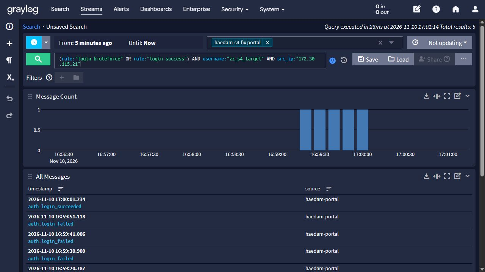
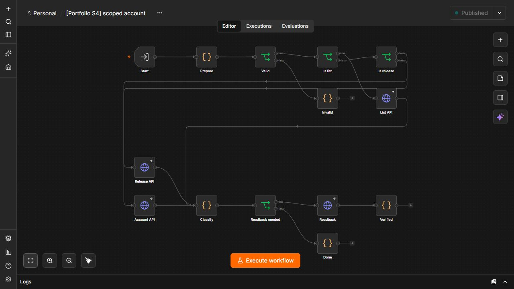
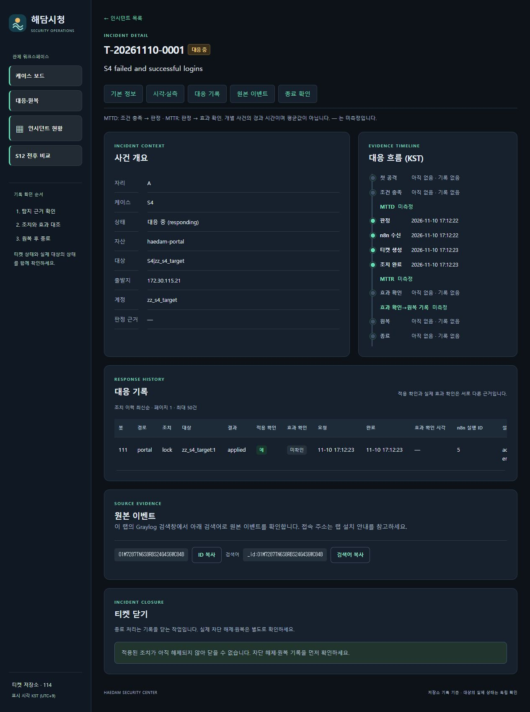
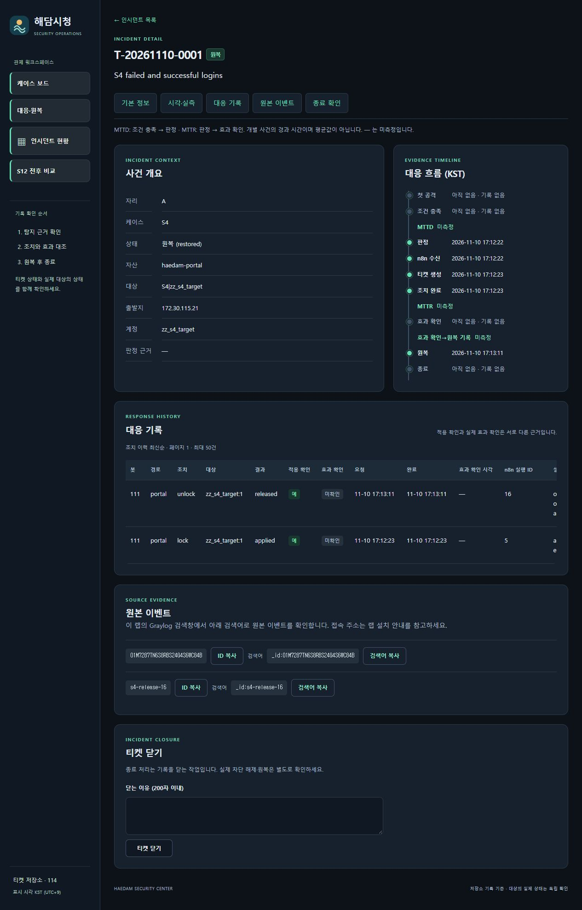

# S4 개인 실제 잠금·티켓·원복 결과

2026-11-10 김명준·Codex. 새 개인 프로젝트 `haedam-s4-fix`와 새 볼륨에서 **실제 로그인 → Graylog 탐지 → n8n 계정 잠금·티켓 → 정상 대조 → 승인 원복을 통과**했습니다. 실행 ID `s4fix20261110`, 기준 코드 `0f81a97`(최신 main 통합 후 HTTP 본문 수정)입니다.

[공개 증적 JSON](evidence/s4-live-20261110.json), [도구·설치 절차](s4-session-evidence.md), [대응 계약](s4-contract.md), [출처](sources.md).

| 확인 | 실제 결과 |
| --- | --- |
| 경계 입력 | 같은 계정·공격 IP에서 401 4건 + 200 1건, Graylog 원천 5건 일치 |
| 경계 관찰 | 탐지 활성 상태에서 11분 이상, 이벤트·티켓 0건. 후속 입력 전 600초 검색창 원천 0건 |
| 탐지 입력 | 같은 계정·공격 IP에서 401 5건 + 200 1건, Graylog 원천 6건 일치 |
| 이벤트 | `01M7287TN6S8RBS24G4S6WC84B` |
| 티켓 | `T-20261110-0001` — 자동 계정 잠금 후 동일 티켓으로 원복 |
| 조건→탐지 | **21.292초** |
| 조건→잠금 API 완료 | **22.734초** |
| 대상 새 로그인 | **200 → 401 → 200**, 세 단계 같은 비밀번호 |
| 대상 원본 세션 2개 | 잠금 후 무효, 원복 후에도 계속 무효 |
| 정상 계정 | 기존 세션 유지, 잠금·원복 단계의 새 로그인 모두 성공 |
| 포털 소유권·티켓 | 잠금 시 사용자 ID·소유 티켓 일치, 원복 후 owner 없음·티켓 restored·활성 조치 0 |
| DB 직접 감사 | 대상/정상 unlocked, S4 claim 0, 대상 옛 세션 행 0·정상 옛 세션 행 유지, IP 차단 0 |
| n8n 데이터 | 원복 후 실행 payload 0, 저장 설정 none 유지 |

시간은 마지막 필수 로그인 이벤트의 원천 시각 `2026-11-10T08:12:00.762000+00:00`부터 Graylog 처리 `2026-11-10T08:12:22.054000+00:00`, 잠금 API 완료 `2026-11-10T08:12:23.496000+00:00`까지의 **한 회차 관측값**입니다. 평균 성능·브라우저 효과 완료 시각으로 표시하지 않습니다. 실제 효과는 별도 세션/로그인 probe로 확인했습니다.

## 설치·인증·망 확인

- 새 개인 서비스 9개와 선택형 observer 1개를 기동했습니다. 포털·MySQL 마이그레이션, Graylog 입력/스트림/인증 알림, n8n 자격증명 5개/게시 워크플로 4개를 연결했습니다. 호스트 localhost 포트와 공격 컨테이너 외부 기본 경로 없음을 확인했습니다.
- 응답·원복 웹훅 각각 키 없음/잘못된 키 403, 유효 키+잘못된 본문 400. baseline 전 티켓 0건입니다.
- baseline 준비는 정상 출발지에서 수행해 공격 검색 키를 오염시키지 않았습니다. 경계 입력의 검색창 만료를 확인하고 trigger6을 실행했습니다. 직접 webhook 전달로 탐지를 대신하지 않았습니다.
- observer는 개인 n8n 망을 공유하며 기존 응답 허용 /32를 확대하지 않았습니다. 원본 쿠키·비밀번호는 normal 전용 private/호스트 번들에 보관하고 공개 JSON·캡처에서 제외했습니다.

## 실제 화면

n8n 캡처는 실제 게시 노드 구성 화면입니다. 실행 성공 근거는 원천 로그·이벤트·계정/세션·티켓·DB 감사이며, 노드 화면 자체를 실행 이력으로 사용하지 않습니다. 추가 티켓/로그 캡처는 같은 증적 폴더에 보관합니다.

## 최초 실패와 수정

첫 회차 `s4live20261110`은 Graylog 이벤트·티켓이 생성됐지만 잠금이 적용되지 않았습니다. 별도 진단 재전송으로 포털 400(`VALIDATION_ERROR`, JSON 객체 필요)을 확인했고 DB에서는 대상 잠금 false·옛 세션 유지·claim 0이었습니다. [실패 증적](evidence/s4-first-failure-20261110.json)을 보존합니다. 진단 webhook 재전송은 자동 탐지 성공으로 표시하지 않습니다.

설치된 n8n HTTP Request 노드의 `sendBody`는 `noDataExpression: true`입니다. 생성기가 동적 표현식을 사용해 본문이 누락되는 경로를 만들었습니다. GET 조회 노드를 분리하고 잠금·해제 POST에 정적 `sendBody: true`, `contentType: json`을 지정했습니다. 오프라인 그래프·Flask 연결 실행기도 지원되지 않는 표현식을 거절하도록 보강했습니다. 수정 후 새 프로젝트·새 볼륨·새 실행 ID로 경계와 전체 흐름을 재실측했습니다.

## 통합 검증·환경 재개·남은 범위

- 최신 main의 Claude README·S4 검토 결과를 통합했습니다. HTTP 본문 수정 후 호스트 **230 passed·115 subtests passed**, 실제 Flask 연결 **11 passed**, S4 생성물 5개 일치.
- 사용자 허용 대상인 기존 Graylog·Wazuh 6개만 일시 중지했습니다. 실측 후 새 개인 S4 10개는 정지하고 볼륨은 보존한 뒤 기존 6개를 원래 ID로 재개했습니다. 기존 Graylog/Wazuh HTTP 200과 핵심 프로세스 정상, MySQL ID/시작 시각·VM 프로세스 ID/시작 시각 유지 확인.
- 공개 JSON의 오프라인 일치 검사는 `provenance_attested=false`를 유지합니다. 실제 실행 근거와 도구 판정을 구분합니다. 시계·계정 ID·회차·소유권·원복 이력이 함께 일치해야 통과합니다.
- 공개 JSON의 `source_sha256`은 S1 증적과 같이 `{path, sha256}` 행 배열로 표현했습니다. 경로의 `token`·`api` 단어 때문에 파일 체크섬을 비밀키로 오인하는 경우를 피하면서 해시 값은 그대로 보존했습니다. `s4_evidence.check`에 전달할 때는 해당 배열을 원래 경로→해시 매핑으로 환원해야 합니다. 환원 후 공개 증적 일치 검사와 두 회차 비밀값 대조, 커밋 범위 Gitleaks 검사(탐지 0)를 통과했습니다.
- 이번 실측은 boundary5/trigger6 및 잠금·정상 대조·원복입니다. 성공 먼저/실패만/성공만/실패 1+성공 5/계정·IP 혼합/429 제외의 모든 유형을 실제 재측정한 것은 아닙니다. 순서를 보장하지 않는 팀 규칙과 알려진 오탐 조건은 유지합니다. 실제 MySQL 재설치 검증과 오프라인 실패 검사를 구분합니다.
- PPT의 S4 실측 표·화면 반영은 후속입니다. 남은 기본 사례는 S12 개인 연결·실측입니다.
